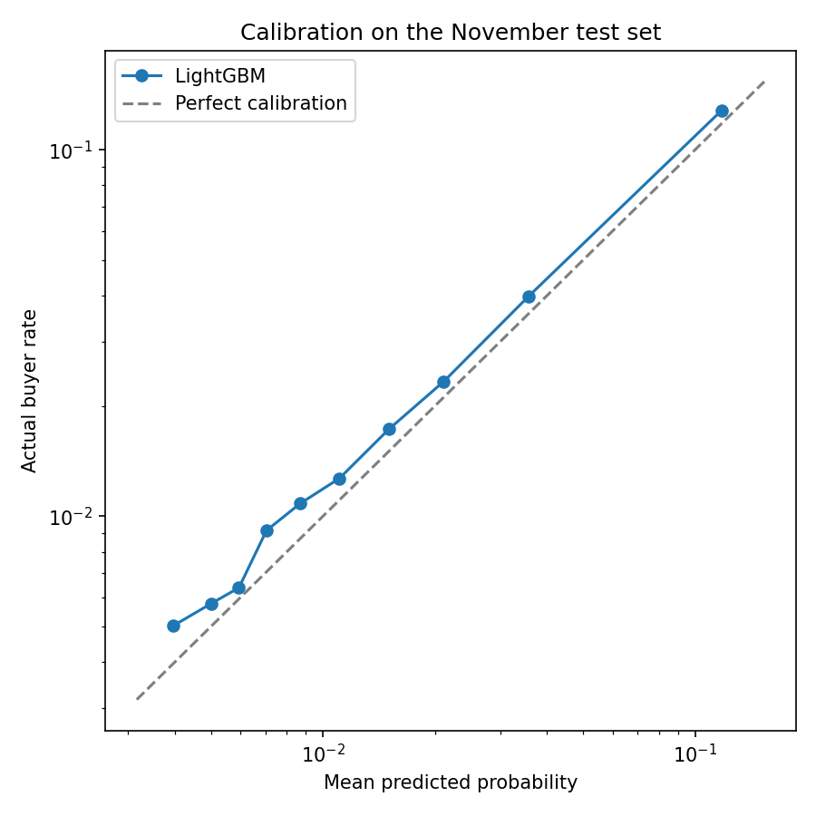
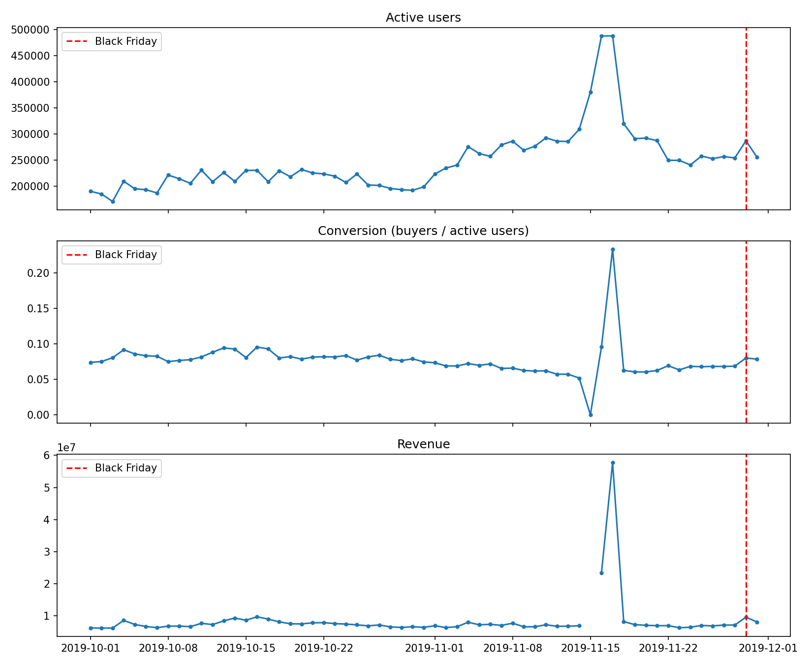
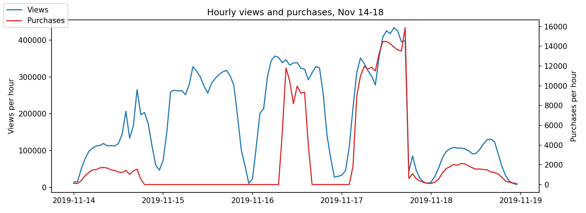

# E-commerce Purchase Prediction

Predicting which users will buy in the next 7 days from 110M e-commerce events, measuring what changed on Black Friday, and evaluating how reliably an open-source LLM can answer questions about the data.

The project uses two months of real behavior logs from a multi-category online store (October and November 2019). It covers data quality auditing, leakage-free prediction design, model comparison and calibration, a Black Friday decomposition with an honest discussion of causal limits, and an evaluation study of a text-to-SQL LLM layer.

## Highlights

- **Prediction:** a LightGBM model ranks 2.6M users by their chance of buying in the next week. On a later, unseen week, its top 1% of users contains **15.5 times** more buyers than a random 1%, and its PR-AUC is **0.205**, versus 0.123 for a "contact past buyers first" rule.
- **First-time buyers:** about half of next-week buyers had never purchased before. Purpose-built intent features improved the model by only about 1%, so the simpler model was kept, and the remaining gap was traced to information missing from behavior data.
- **Data quality:** hourly analysis revealed that purchase tracking switched off and on for three days in mid-November while traffic stayed high, so those days were excluded from every baseline.
- **Black Friday:** revenue was about **40% higher** than the prior week, with roughly half of the increase coming from higher conversion. Discounts were limited: the median product price did not change.
- **LLM evaluation:** an open-source LLM answered 90% of schema-worded questions correctly, but only **60%** of loosely worded ones, and every remaining error was a silent wrong answer rather than a visible failure.

## Data

[eCommerce behavior data from multi category store](https://www.kaggle.com/datasets/mkechinov/ecommerce-behavior-data-from-multi-category-store) on Kaggle. Each row is one event (a product view, an add-to-cart, or a purchase) with a timestamp, product, category, brand, price, user, and session: 9 columns in total.

| Month | Raw events | Exact duplicates removed | Clean events |
|---|---|---|---|
| October 2019 | 42,448,764 | 30,220 (0.07%) | 42,418,544 |
| November 2019 | 67,501,979 | 100,519 (0.15%) | 67,401,460 |

The data is not included in this repository. See [How to reproduce](#how-to-reproduce).

## Project structure

```
notebooks/
  purchase_prediction.ipynb   Data audit, cleaning, features, models, calibration, Black Friday analysis
  llm_query_layer.ipynb       Text-to-SQL with an open-source LLM, and its evaluation
results/
  calibration.png
  daily_trends.png
  anomaly_hourly.png
```

## 1. Data quality audit

Before any modeling, the data was checked for completeness, duplicates, invalid values, and assumptions about user behavior.

- **Carting is not a required step.** 53.5% of purchased products were never added to cart by that user during the month. A standard view, cart, purchase funnel would therefore be misleading, so the prediction target is purchase directly.
- **Missing values:** `category_code` is missing for 31.8% of events, but `category_id` is complete and is used for grouping. `brand` is missing for 14.4% and is labeled "unknown."
- **Zero prices:** 68,673 events have a price of zero, all of them views or carts, so revenue is unaffected. They are excluded only from price-based features.
- **Duplicates:** exact duplicate rows were removed, and row counts were reconciled after every cleaning step.

## 2. Predicting next-week purchases

### Setup

| | Feature window | Label window | Users | Buyer rate |
|---|---|---|---|---|
| Training | Oct 1 to Oct 24 | Purchased Oct 25 to Oct 31? | 2,559,818 | 2.43% |
| Test | Oct 8 to Oct 31 | Purchased Nov 1 to Nov 7? | 2,596,037 | 2.58% |

Features never overlap the label window, and the test set predicts a later period than training (out-of-time validation). Both feature windows are 24 days long and are built by the same function, so features mean the same thing in training and testing. Nineteen user-level features were built from the 9 raw columns, covering activity, recency, recent momentum, browsing breadth, spending, and intent ratios.

### Results on the November test week

Because only about 2.5% of users buy, accuracy is not meaningful. Models are compared on ranking quality (ROC-AUC, PR-AUC) and lift: how many times more buyers are found in the top-scored group than in a random group of the same size.

| Approach | ROC-AUC | PR-AUC | Lift, top 10% |
|---|---|---|---|
| Random | 0.500 | 0.026 | 1.00 |
| Rule: most recently active first | 0.668 | 0.051 | 2.49 |
| Rule: past buyers first, then recency | 0.766 | 0.123 | 4.77 |
| Logistic regression | 0.789 | 0.192 | 4.78 |
| **LightGBM** | **0.800** | **0.205** | **4.96** |

| Top-scored users | Past-buyer rule | Logistic regression | LightGBM |
|---|---|---|---|
| Top 1% | 9.11 | 14.76 | **15.46** |
| Top 5% | 6.43 | 6.94 | **7.21** |
| Top 10% | 4.77 | 4.78 | **4.96** |
| Top 20% | 3.06 | 3.18 | **3.25** |

The models' advantage over the simple rule is concentrated at the very top of the ranking: in the top 1%, about 40% of users selected by LightGBM buy within a week, versus about 24% under the rule. LightGBM's validation PR-AUC (0.214) is close to its test PR-AUC (0.205), so it generalizes to a later period without obvious overfitting.

### The hard part: first-time buyers

88.9% of test users had never purchased. Their next-week buyer rate is only 1.46%, yet they account for **50.4% of all next-week buyers**. A rule based on purchase history cannot find them.

Both models find some signal in this group (LightGBM PR-AUC 0.041, lift 3.03 at the top 10%), but much less than for past buyers. Nine intent-focused features were then added, such as repeated views of the same product, items carted but not bought, and activity in the last 3 days. On their own, they clearly separate buyers from non-buyers (for example, carts in the last 3 days were about 7 times higher among first-time buyers). Added to the model, however, they improved PR-AUC by only about 1%, because their information overlaps with existing features. **The simpler model was kept.** Predicting first-time purchases from browsing alone appears close to its limit; the missing signal likely lives in data not available here, such as marketing exposure or user attributes.

### What drives the model

- **Purchase history is the strongest signal.** Purchase-related features account for about 65% of gain importance, led by days since last purchase.
- **Recent activity has the broadest influence.** In SHAP values, days since last activity and events in the last 7 days rank near the top, because they affect every user, not only past buyers.
- **Cart features contribute almost nothing**, consistent with the audit finding that most purchases skip the cart.

### Calibration



The model underestimates purchase probability by about 10% overall (average prediction 2.31% vs. actual 2.58%), and all ten groups are underestimated by a factor of 1.09 to 1.28. The curve runs parallel to the diagonal, so the ranking is reliable and the error is a consistent shift in level, most likely because early November had a higher buyer rate than late October. For ranking users, the model can be used as is; for forecasting buyer counts, it should be recalibrated regularly on the most recent week.

## 3. Black Friday analysis

### A data quality incident first



Daily metrics showed an extreme spike in mid-November. Hourly data explained it:



From the evening of November 14 to the evening of November 17, purchases switch off and on abruptly while views stay at 2 to 4 times their normal level. Real customer behavior does not change this sharply, so this points to an interruption in purchase tracking during a high-traffic event. These days were excluded from all baselines. The model's test window (November 1 to 7) is not affected.

### What changed on Black Friday (November 29, 2019)

Revenue was split into four components: active users × conversion × items per buyer × average price.

| Comparison | Revenue change | From conversion | From more users | From higher prices |
|---|---|---|---|---|
| vs. previous Friday | +37.8% | 45% | 43% | 12% |
| vs. prior-week average | +40.3% | 50% | 39% | 13% |
| Saturday after vs. previous Saturday | +27.9% | 88% | 10% | 4% |

- **Visitors were much more likely to buy.** Against normal November days, Black Friday conversion (z = 3.1) and revenue (z = 5.5) were far outside normal variation, while active users (z = 0.8) were not. Items per buyer did not change: more people decided to buy, rather than each buyer buying more.
- **Discounts were limited.** Among 81,434 products viewed both on Black Friday and in the prior week, the median price change was 0%, and only 9.8% were discounted by 5% or more. Purchased products were on average 2.3% cheaper.
- **Buyers chose more expensive items.** The average purchase price still rose about 4%. Computers (+61% revenue) and appliances (+58%) grew fastest, but electronics kept about 77% of revenue, so most of the shift likely happened within categories, toward higher-end models.

### Why this is not a causal estimate

The roughly 40% increase is associated with Black Friday, but it cannot be attributed to the store's promotion alone. There is no control group; holiday shopping intent rises across the market regardless of discounts; a 2.3% average discount is unlikely to explain a 16-18% rise in conversion on its own; the mid-November event may have shifted demand, but its purchase data is unreliable; marketing activity is unknown; and this is a single event.

## 4. LLM query layer

An open-source model, Qwen2.5-Coder-7B-Instruct, runs on a free Kaggle GPU in 4-bit precision. Given a description of two small curated tables and a question in plain English, it writes a DuckDB SQL query. Queries are checked before running, and only a single read-only statement is allowed.

### Evaluation design

- **41 questions with gold SQL answers:** 31 written using the schema's terms, across 7 question types, plus a **held-out set of 10** in looser, more user-like wording.
- Results are compared by value rather than SQL text, ignoring column names, extra columns, and row order.
- A second version (v2) added general SQL rules to the prompt and one retry on errors. The held-out questions were never used to tune the prompt.

### Results

| Question set | v1 | v2 (rules + retry) |
|---|---|---|
| Original 31 | 90.3% | 93.5% |
| Held-out 10 | 60% | 70% |

1. **Wording matters.** Accuracy fell from 90% to 60% on loosely worded questions. With 10 questions the estimate is imprecise, but the gap shows that schema-worded test questions flatter the model.
2. **Prompt changes need a full re-test.** v2 fixed all three original failures but broke two questions v1 had answered correctly, for example reading "8 million" as 8.
3. **The errors that remain are silent.** The retry never triggered, because no v2 query failed. Every remaining error ran successfully and returned a plausible-looking but wrong result, such as averaging daily ratios when the question explicitly asked for total revenue divided by total purchases.

**Implication:** answers from a model of this size should not be trusted without review. A practical deployment would show the generated SQL alongside the result, add automatic checks such as expected row counts and plausible magnitudes, and use a stronger model or worked examples in the prompt.

## Limitations

- Two months of data from one store, with timestamps in UTC rather than the store's local time.
- No information on marketing, user attributes, or product availability, which limits both first-time-buyer prediction and causal conclusions about Black Friday.
- Purchase records for November 14 to 17 are unreliable.
- The LLM evaluation uses a small question set, so its accuracy estimates have wide uncertainty.

## Tools

Python, SQL (DuckDB), pandas, scikit-learn, LightGBM, matplotlib, Hugging Face Transformers, Kaggle Notebooks

## How to reproduce

1. Open the dataset on Kaggle and create a notebook with it attached, or download it with the Kaggle API:
   ```
   kaggle datasets download -d mkechinov/ecommerce-behavior-data-from-multi-category-store
   ```
2. Run `notebooks/purchase_prediction.ipynb` from top to bottom on a CPU session. Set `RUN_DATA_PREP = True` the first time to build the cleaned Parquet files from the raw CSVs.
3. Run `notebooks/llm_query_layer.ipynb` on a GPU session, with the first notebook's output attached as an input.

Notebooks on Kaggle: [Purchase prediction](https://www.kaggle.com/code/guilinzhao/e-commerce-purchase-prediction), [LLM query layer](https://www.kaggle.com/code/guilinzhao/llm-query-layer)
